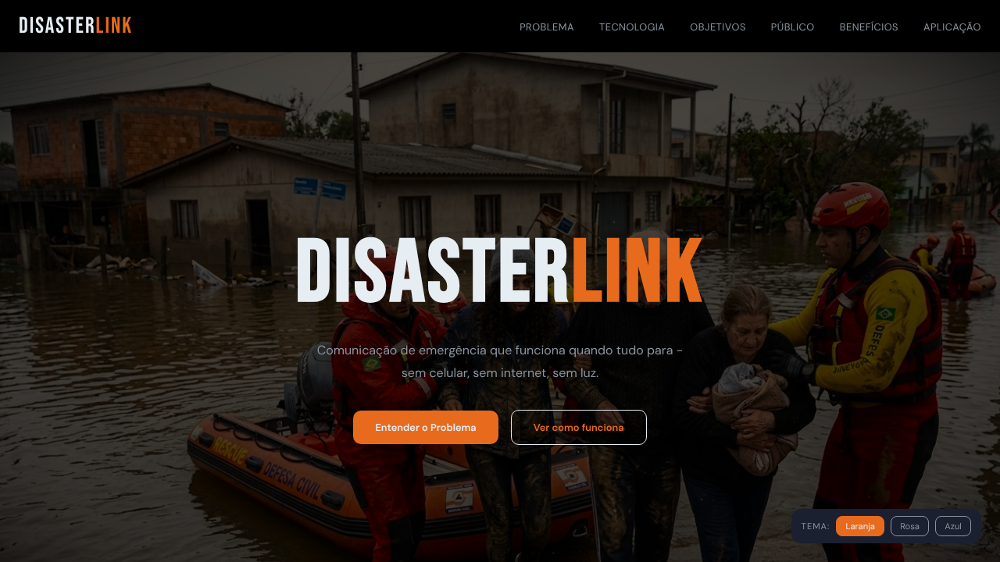
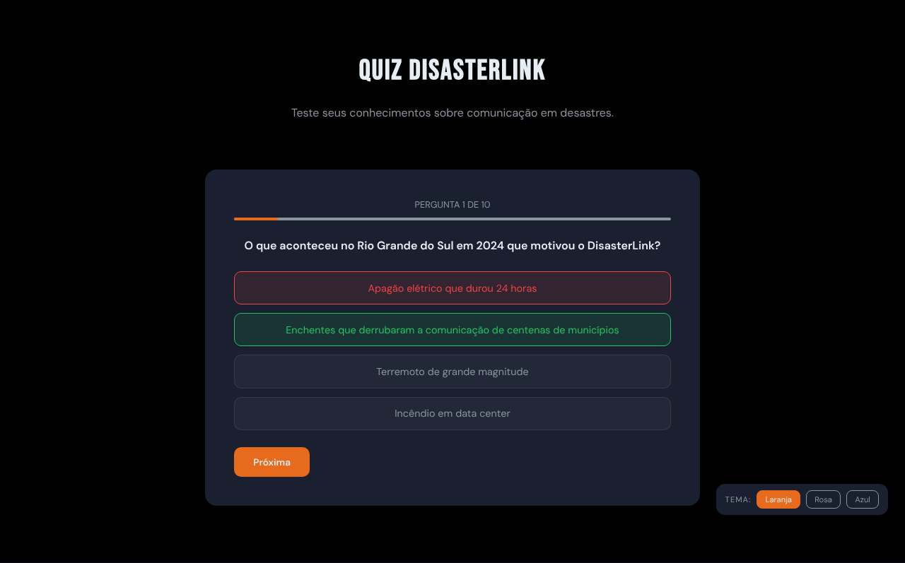
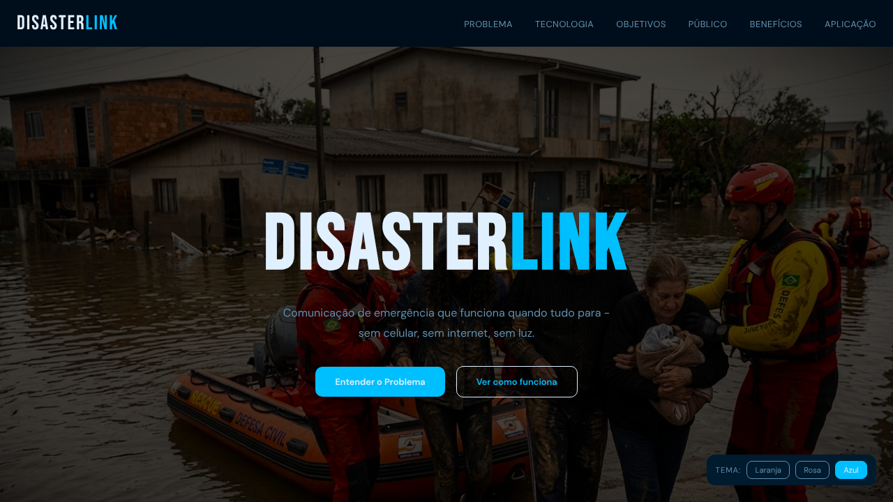

<div align="center">

# 🚨 DisasterLink · Site Interativo

**A versão interativa do site do DisasterLink, com slideshow, quiz, formulário de contato e troca de tema**


<sub>Web Development · Global Solution 2026.1 · Space Connect · FIAP</sub>



</div>

---

## Sobre o projeto

Quando uma enchente, um desabamento ou um incêndio acontece, a comunicação costuma cair junto: sem sinal de celular, sem internet e, muitas vezes, sem luz. As vítimas não conseguem pedir socorro, as equipes de resgate não sabem para onde ir e a Defesa Civil coordena as ações às cegas. Foi o que aconteceu no Rio Grande do Sul em 2024, quando municípios inteiros ficaram dias sem comunicação.

O **DisasterLink** nasceu para manter esse canal aberto. A solução completa reúne um **kit de emergência portátil**, uma central de comando para a Defesa Civil e um aplicativo para as equipes de resgate. O kit recebe os pedidos de socorro das vítimas por rádio LoRa e envia as informações pela rede 4G ou, quando ela falha, pelo satélite Iridium. Assim, a comunicação funciona em qualquer lugar do planeta, sem depender da infraestrutura terrestre.

Este repositório traz o **site interativo** do DisasterLink. Ele tem a mesma base da [landing page](https://github.com/SpaceConnect-DisasterLink/landing-page) e acrescenta interação com JavaScript: um slideshow com imagens da solução, um quiz para testar o que a pessoa aprendeu sobre desastres, um formulário de contato com validação e um botão que troca as cores da página.

O objetivo é simples: que nenhum pedido de socorro se perca quando a comunicação cai, e que o resgate chegue primeiro a quem mais precisa.

---

## Seções da página

| Seção | O que mostra |
|---|---|
| **Início** | O slogan da solução, uma imagem de impacto e os botões de navegação |
| **Problema** | Como a comunicação cai nos desastres, com o caso do Rio Grande do Sul em 2024 |
| **Tecnologia** | Os módulos do kit de emergência, em cards |
| **Objetivos** | As metas da solução, em cards numerados |
| **Público-alvo** | Quem a solução ajuda diretamente |
| **Benefícios** | As principais vantagens do DisasterLink |
| **Aplicação** | O caminho completo do desastre até o resgate, em 5 etapas |
| **Slideshow** | Galeria de imagens da solução, com troca manual e automática |
| **Quiz** | 10 perguntas sobre desastres e sobre o DisasterLink |
| **Contato** | Formulário para quem quer saber mais ou apoiar a solução |

## Funcionalidades interativas

| | |
|---|---|
|  |  |
| Quiz com barra de progresso e resposta certa ou errada | O mesmo site depois de trocar para o tema azul |

| Funcionalidade | Como funciona |
|---|---|
| **Slideshow** | Setas de anterior e próximo, e troca automática a cada 5 segundos. Ao chegar na última imagem, volta para a primeira. |
| **Quiz** | 10 perguntas com barra de progresso, resposta certa ou errada em cada uma e placar no final. Depois da primeira escolha, as opções ficam bloqueadas. |
| **Formulário** | Confere os campos antes de enviar, mostra o erro de cada um e exibe uma mensagem de sucesso. |
| **Troca de tema** | Botão flutuante que muda as cores da página inteira entre laranja, rosa e azul. |

---

## Como executar

### Pelo terminal

```bash
# Clone o repositório
git clone https://github.com/SpaceConnect-DisasterLink/site-interativo.git

# Entre na pasta
cd site-interativo
```

Depois, abra o arquivo `index.html` no navegador (é só dar dois cliques nele).

<details>
<summary><b>Pelo VS Code</b></summary>

1. Abra o VS Code e clique em **File > Open Folder**
2. Selecione a pasta do projeto (site-interativo)
3. Instale a extensão **Live Server**
4. Clique com o botão direito no `index.html` e escolha **Open with Live Server**

</details>

---

## Estrutura

```
site-interativo/
├── index.html        ← Estrutura completa da página
├── css/
│   └── style.css     ← Estilos, temas e responsividade
├── js/
│   └── script.js     ← Slideshow, quiz, formulário e troca de tema
├── images/
│   ├── hero.jpeg     ← Imagem da seção inicial
│   ├── problema.jpeg ← Imagem da seção Problema
│   ├── publico.jpeg  ← Imagem da seção Público-alvo
│   ├── slide1.png    ← Imagens do slideshow
│   ├── slide2.png
│   ├── slide3.png
│   └── logo.png      ← Logo do DisasterLink
├── docs/             ← Imagens deste README
├── AI.md             ← Uso de inteligência artificial no projeto
└── README.md         ← Este arquivo
```

---

## Limitações desta versão

O site é um **protótipo acadêmico**. Nesta versão:

- O formulário só valida os campos e não envia os dados para nenhum lugar.
- O tema escolhido não fica salvo: ao recarregar a página, ela volta às cores padrão.
- Não há interação com o kit ou com a central de comando.

## Uso de IA

O uso de IA no site está documentado no arquivo [AI.md](AI.md): o que foi pedido, o que a IA respondeu e o que o grupo aceitou ou mudou.

## Tecnologias utilizadas

- **HTML5:** estrutura e marcação semântica.
- **CSS3:** estilização, variáveis de tema, Flexbox e responsividade.
- **JavaScript:** slideshow, quiz, validação do formulário e troca de tema.
- **Google Fonts:** Bebas Neue nos títulos e DM Sans no texto.

## Equipe

| Nome | RM |
|---|---|
| Caique Kenji Yafuco | 570368 |
| Guilherme Tomé Nogueira | 570144 |
| Lucas de Andrade Astorini | 569119 |
| Sabrina Lopes da Silva | 571870 |
| Sofia Satomi Hagio | 569120 |
